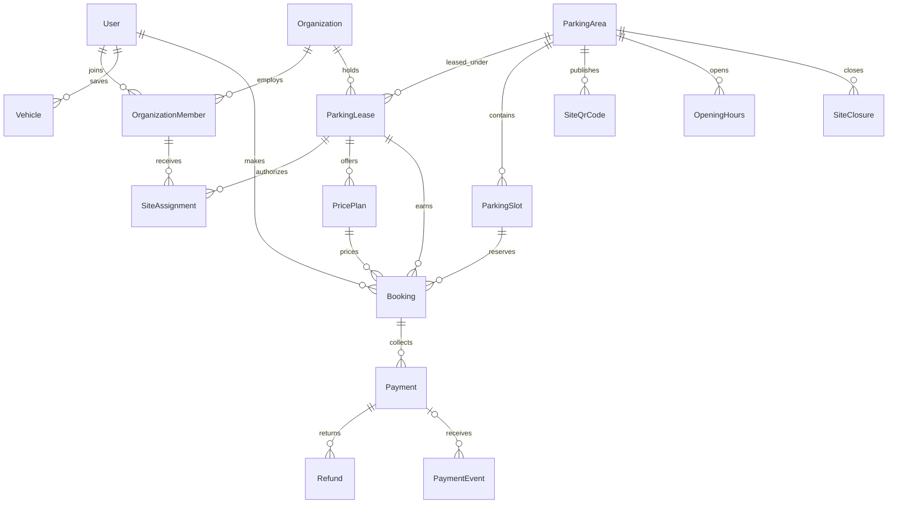

# Parking database design

This is the target MySQL/Prisma schema. It has been validated locally, but has not been migrated into a database. The administration console and protected setup APIs now use this structure; see [admin-panel.md](admin-panel.md) for setup and usage. The customer booking/payment services remain a separate implementation step.

## Ownership and operation

An organization is a leaseholder company. A parking area is a physical site. `ParkingLease` connects them for a specific period and work order, preserving history when operators change. One organization can lease many sites; each site has at most one operating lease for any instant. The authority field identifies the site owner/municipality; property-title management and lease-rent accounting are outside this initial design.

Staff are users with organization memberships and optional site assignments. An individual may work for multiple organizations. Site assignments belong to a lease, so an old operator does not retain operational access when a new lease begins.

## Access policy

| Scope | Role | Intended access |
| --- | --- | --- |
| Platform | SUPER_ADMIN | All organizations, sites, users, bookings, payments, and services |
| Platform | USER | Own profile, vehicles, bookings, and receipts |
| Organization | OWNER / ADMIN | Manage their organization, memberships, leased sites, and reports |
| Organization | ACCOUNTANT | Financial reports and authorized refund operations for their organization |
| Organization | VIEWER | Read-only organization operational records; no financial ledgers |
| Organization | MEMBER | Basic staff membership; operational access requires site assignments |
| Site lease | MANAGER | Assigned site operations, pricing, and staff assignments within their authority |
| Site lease | OPERATOR | Assigned site bookings, entry, exit, and occupancy |
| Site lease | TICKET_COLLECTOR | Assigned site tickets and authorized collections |
| Site lease | VIEWER | Assigned site read-only operations |

The role-aware admin API now enforces these scopes; see [staff-access.md](staff-access.md). Organization roles and site roles are separate grants. Use MEMBER membership for operational staff and add site assignments. Booking/payment write services are still pending; operators and collectors currently have scoped read access. Only trusted platform administration may grant SUPER_ADMIN; registration must always default to USER. No seeded superuser credentials are included.

## Booking, time, and pricing

1. Scan a published site QR. Resolve its token, reject revoked/expired codes, and load the active site and lease. The QR is public discovery, not an authentication credential.
2. Authenticate the customer, select a vehicle type, price plan, slot, and start time. Set the end time from the plan duration. An immediate booking uses the current time.
3. Create a short HELD booking with a mandatory hold expiry and a unique idempotency key. Preserve the registration and pricing snapshot even if the saved vehicle or tariff later changes.
4. Confirm after verified payment, or according to an explicitly enabled pay-at-exit policy. Record actual entry/exit separately from the reserved interval.
5. Calculate overtime from the saved tariff, collect any balance, and complete the booking. Expire abandoned holds and mark no-shows through a background worker.

Plans are fixed-duration packages per vehicle type and lease, with effective dates, grace minutes, and an overtime billing unit. For example, 60 minutes at INR 20 uses `priceMinor=2000`; each started additional 60-minute unit can cost `overtimePriceMinor=2000`. Use ceiling division after subtracting grace time. More advanced peak-hour calendars or progressive slabs would require additional tariff-rule tables.

Store absolute times in UTC, interpret opening hours in the area's IANA timezone, and use half-open intervals `[startsAt, endsAt)`. Opening hours use weekdays 0–6 (Monday–Sunday), with minutes from midnight; `[0,1440)` means a full day, no rows means closed. Split overnight hours across days. Site closures override opening hours.

Money is stored in integer minor units, never floating point. Serialize Prisma BigInt values as decimal strings in JSON. All totals, payment amounts, and snapshots are calculated on the server. Snapshot tariff name/version, duration, grace, overtime units/rate, currency, and tax/discount rules. Treat sold price plans as immutable; publish another row when prices change.

## Required transactional invariants

Foreign keys, unique keys, unsigned values, and query indexes are in the schema. The following cross-row and business rules still require service transactions (and custom SQL constraints where appropriate); Prisma validation alone does not enforce them:

- Lease dates and booking dates must increase. Prevent overlapping non-cancelled operational leases by locking the physical site before checking/inserting/activating leases. Drafts are not bookable. Bookings must fit within the lease interval.
- Membership organization must match assignment lease organization. Booking slot and QR must belong to the lease's site; the plan must belong to that lease. A saved vehicle must belong to the booking user. Vehicle types must match the slot and plan.
- Hold expiry is required for HELD bookings. Check lease, organization, site, slot, opening hours, closure periods, and plan availability before accepting a booking. Durations and overtime units must be positive; validate weekday/minute bounds and non-overlapping hours. Require at least one verified login identifier for customers.
- Prevent double booking by locking the slot row with `SELECT ... FOR UPDATE` inside an interactive transaction, then performing a current/locking overlap read and inserting the reservation. Block CONFIRMED reservations and unexpired HELD reservations when `existing.startsAt < requested.endsAt AND existing.endsAt > requested.startsAt`. All booking, extension, reassignment, and confirmation paths must use the same locking protocol. Retry transaction deadlocks with bounded retries. A unique key on start time is insufficient for interval overlaps.
- CHECKED_IN bookings require an explicit overstay policy: conservatively block further allocation on that slot until checkout, and check physical occupancy again at entry. Future reservations may require reassignment if a vehicle overstays; reservation end time alone is not proof that a slot is vacant.
- Confirm a hold only if it remains valid and the slot is still available under the lock. A late successful payment on an expired hold must be refunded or manually reconciled, never blindly confirmed.
- Check state transitions: HELD → CONFIRMED/EXPIRED/CANCELLED; CONFIRMED → CHECKED_IN/CANCELLED/NO_SHOW; CHECKED_IN → COMPLETED. Record cancellation and actual timestamps consistently. Audit authorized corrections instead of silently reopening terminal records.
- Enforce `totalMinor = subtotalMinor + taxMinor + overtimeMinor - discountMinor >= 0`. Match payment currency to booking currency. Keep payment attempts separate from booking status. Lock payment records when creating refunds and count pending plus successful refunds against the captured amount to prevent excess refunds. Refund provider must match payment provider.
- Namespace client idempotency keys by user and operation, compare repeated request payloads, and check ownership before returning previous results. Verify gateway signatures before processing events; insert/deduplicate event IDs and apply payment changes atomically. Handle out-of-order events without regressing successful payments. A browser redirect or UPI launch does not prove payment.
- Audit sensitive actions, including role changes, price changes, cash collections, refunds, and booking transitions, in the same transaction. Store the organization/lease context and actor in audit metadata. Restrict audit updates/deletes at the database/service layer, and do not log credentials or full payment payloads.

Capacity is the count of non-retired slots, sellable capacity excludes out-of-service slots, and availability is computed for the requested interval. Do not maintain a second mutable capacity or occupied flag that can drift from slot/booking records. Financial and lease history use restrictive deletes; deactivate records instead of removing referenced history.

## Migration and integration

The schema intentionally replaces `ParkingOperator` with `Organization`, moves work-order/tenure data from `ParkingArea` into `ParkingLease`, and replaces global staff roles with scoped memberships. This is a breaking schema change, not an additive migration.

Before applying it to an existing database:

1. Back up and inspect existing data, then create a reviewed staged migration. Add new tables first, backfill, validate, and only then remove old columns/tables. Do not use `db push` as a data-preserving migration strategy.
2. Map each old operator to an organization. Convert area operator/work-order/tenure fields into leases. Interpret old date-only tenure boundaries in the site's timezone; an inclusive final lease date becomes midnight on the following day converted to UTC.
3. Map user contacts, resolve duplicate normalized phone/email values, create memberships/site assignments, and explicitly review ADMIN/GMC_OFFICER access. Do not automatically promote legacy ADMIN accounts to SUPER_ADMIN.
4. Create individual slot records from verified capacity and vehicle allocations. Convert old slot validity/rates into price plans; no authoritative pricing table exists in the old schema.
5. Use the new protected `/api/admin/resources` setup APIs for organizations, sites, leases and assignments. Legacy `/api/operators` and `/api/parking-areas` endpoints now return 410; their previous `ticketCollector` relation was absent from the old schema. Use site assignments instead.
6. Platform and scoped staff authentication/setup authorization are implemented. Add booking/payment services, gateway verification, and database transactional integration tests. Replace the frontend mock registry/local booking flow with those APIs. The Prisma client has been regenerated; apply the migration in staging and verify backfilled counts and behavior before production.

Validation performed for this phase: Prisma schema formatting and validation. No database was modified, no migration was applied, and runtime booking/payment behavior has not yet been implemented or tested.
